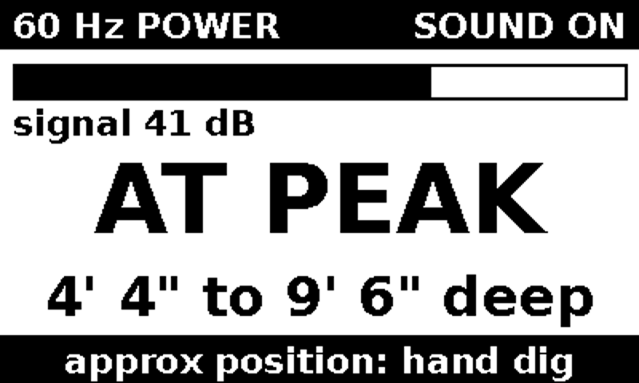
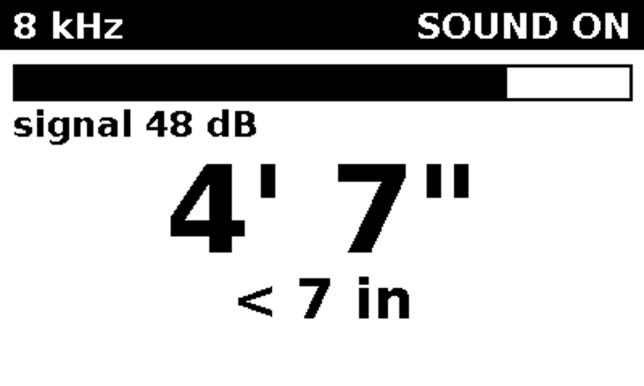

# PowerlineLocator

### Current stage: 0. Design done, simulation passes, nothing bought yet. Build Stage 1 first.

**A Raspberry Pi buried cable locator you can build and lend out.** It finds buried power cables (and any other metal line you can put a signal on) down to 4 to 6 ft, shows how deep they are and which way to step, and warns you when the reading can't be trusted. It's meant for places where calling a locating contractor out for every post hole isn't realistic, and where one good tool can go round a whole neighbourhood.

It works the way commercial locators do, and it's built in two stages:

* **Stage 1, the receiver on its own (about $445).** A staff with four pickup coils listens for the 60 Hz a live, loaded cable already carries. It finds the line's **peak** and gives a **depth range**. No transmitter, nothing connected to any cable.
* **Stage 2, adding a transmitter and clamp (about $195 more).** The transmitter puts a signal of its own on the line, which adds an arrow, a single trustworthy depth and a distortion warning, and lets it find dead lines, metal pipe and tracer wire too.

Stage 1 alone covers the most common job: "where does my live cable run, and roughly how deep?" Nothing in Stage 1 changes or gets thrown away when you add Stage 2.

> **Call 811 for public and utility lines. This is for lines you ran yourself and stupidly didn't mark it.**

---

## Here's the whole build (both stages)

```text
   STAGE 2: TRANSMITTER (battery box)              STAGE 1: RECEIVER (a 4 ft staff)

   Raspberry Pi Pico                               ┌───────────────────────────┐
     │ makes 8 kHz / 33 kHz / 90 Hz                │ head box: Pi 4, Sharp     │
     ▼                                             │ screen, 2 buttons, buzzer │
   DRV8871 H-bridge ◄── 12 V LiFePO4               └────────────▲──────────────┘
     │ ±13 V square-ish wave                                    │ USB
     ▼                                             ┌────────────┴──────────────┐
   TVS clamp → 22 Ω → 1 A fuse                     │ Behringer UMC404HD        │
     │                                             │ 4 mic preamps + ADC       │
     ├── RED ──► dead line (direct)  ─┐            └──▲─────▲─────▲─────▲──────┘
     │      or ► clamp round a live   │               │ XLR │     │     │
     └── BLACK ► ground stake         │              top H  top V │     │   600 mm up
                                      │                           │     │
                                      ▼                        bottom H  bottom V   100 mm up
   ══════════════════════════ buried cable ══════════════════════════════════════
           signal current out along the cable, back through the earth
```

Pictures: [SCHEMATICS.md](SCHEMATICS.md). Parts with search phrases and links: [PARTS.md](PARTS.md). Step-by-step build for someone who has never wired anything: [for_dummies.md](for_dummies.md).

---

## How it works

### The field

A long straight wire carrying current I has a magnetic field that circles it:

**B = μ₀ I / (2π r)**

* **B:** magnetic flux density, in tesla.
* **μ₀ = 4π × 10⁻⁷ T·m/A:** the permeability of free space. Soil isn't magnetic, so it barely changes this; that's why locating works straight through dirt.
* **I:** the current on the line. Typically 20 to 200 mA from the transmitter.
* **r:** distance from the wire to the sensor.

The field points around the wire, not away from it. So a coil a horizontal distance x to the side and a height h above the wire sees two parts:

**Bx = k h / (x² + h²)    By = k x / (x² + h²)    with k = μ₀ I / (2π)**

Directly over the wire (x = 0) the vertical part By is zero and the horizontal part Bx is at its peak. Step off to one side and By grows, with a sign that says which side.

### Depth from a ratio (with the transmitter)

The staff has two horizontal coils, one d = 0.5 m above the other. Over the wire, the bottom one is at height h and the top one at h + d, so

**Bx(bottom) / Bx(top) = (h + d) / h  ⇒  h = d · Bx(top) / (Bx(bottom) − Bx(top))**

The current I is inside k, and it cancels. You never need to know how much current is on the line, which is the whole reason this works: the earth return path, the line's resistance and the ground stake are all unknowns, and none of them matter. (It's the same move as SlightlyCutGem's contrast measurement and a Bell test's correlation: divide one reading by another to cancel what you can't calibrate.)

The price is sensitivity. At 6 ft the two readings differ by only about 20 %, so a 1 % error in their ratio becomes about a 5 % error in depth. That's why the coils must be **calibrated** against each other to well under 1 % (`calibrate.py`), and why calibration is the hardest part of the build, not the electronics.

### Four coils, three unknowns, one spare (with the transmitter)

The software doesn't actually assume you're standing over the line. It has four readings (two horizontal, two vertical coils) and fits three unknowns: the line's sideways position x, its depth, and its strength k. That gives depth even when you're off to one side, and the left/right arrow.

The fourth reading is spare, and it's the most useful feature for a tool you lend out. A single straight line makes a field with a very particular shape; if the four readings don't fit that shape, something is bending the field: a second line, a fence, a tee, a bend, or signal coming back along a shallow wire. When the misfit is more than 8 % of the signal (and clearly more than noise), the screen says **DISTORTED, depth unreliable** and puts the depth in brackets.

**Known limit:** two parallel lines close together (closer than about half their depth) make a field that really does look like one line between them, and no four-coil locator can tell. The distortion check catches a line well off to the side or much shallower; it can't catch a pair in one trench.

### Hearing one frequency: the lock-in

Each coil's voltage, from Faraday's law, is

**V = N A μ_eff ω B**

* **N ≈ 1000:** turns of wire.
* **A ≈ 7.9 × 10⁻⁵ m²:** the rod's cross-section (10 mm diameter).
* **μ_eff ≈ 60:** how much the ferrite rod concentrates the field. It's set mostly by the rod's length-to-diameter ratio, not the ferrite's own permeability.
* **ω = 2πf:** the signal's angular frequency. Voltage grows with frequency, which is why locators use kilohertz, and why a coil can't see DC at all (ω = 0 gives V = 0).
* **B:** the field from above.

At 6 ft with 100 mA at 8 kHz that's a few millivolts, which is plenty. The receiver multiplies each channel by a sine and cosine at exactly the transmitter's frequency and averages (a software lock-in amplifier), which rejects everything else: 60 Hz hum, radio noise, the Pi's own switching. All four channels come from one ADC clock, so their relative phases are real: in phase means the line is on one side, opposite phase means the other.

### Power mode (Stage 1): why it gives a peak and a range

A live cable is **two** currents: hot out and neutral back (or L1 and L2 on a 240 V pump), a spacing s apart, equal and opposite. From above, their fields mostly cancel, leaving a **dipole** field that falls one power faster than a single wire's:

**B ≈ μ₀ I s / (2π r²)**

* **I:** the load current in each conductor. **The line has to be carrying current:** turn on a big load at the far end.
* **s:** the conductor spacing, about 1 cm in a cable. It's the small lever arm that keeps the cancellation from being complete.
* **r²:** one power faster than 1/r. It's the same multipole ladder as a charge (1/r²) versus a dipole (1/r³), one dimension down for line currents.

On top of that there's usually some **net** current: neutral current that comes home through the earth or other bonded paths instead of the neutral wire. That part behaves like a single wire, and on twisted cable (most direct-burial triplex) it's most of what reaches the staff, because the twist cancels the pair's field within a foot or so.

So a live cable is an **unknown mix** of a single-wire field and a pair field. That breaks the active-mode fit in two ways, and it's physics, not software:

* **A mix looks like a single wire shifted sideways.** A pair plus a little net current makes a field that's lopsided toward one side. In simulation, the four-coil fit put the line up to 55 cm (22 in) off, with no warning. No coil arrangement can tell that shift apart from a real line in a different place.
* **The two parts fall off differently**, so one ratio can't give one depth.

Power mode does what commercial locators do instead:

**It finds the peak of an orientation-proof strength.** At each pair of coils (one horizontal, one vertical) the total field |B| = √(Bx² + By²) peaks right over a single wire, and also right over a pair at *any* orientation, side by side or stacked. Power mode follows the **gradient**, |B(bottom)| − |B(top)|, which peaks in the same place about 40 % more sharply. (The horizontal coil on its own would be a bad choice: a side-by-side pair puts its peak more than 3 ft off the line.) The screen shows how far below the held peak you are, and **AT PEAK** within 0.3 dB of it.

**It gives a depth range.** With R = |B(bottom)| / |B(top)| over the line and d = 0.5 m between the pairs:

* **Single wire** (falls as 1/r): R = (h + d)/h, so **h = d / (R − 1)**
* **Pair** (falls as 1/r²): R = ((h + d)/h)², so **h = d / (√R − 1)**

Any mix falls somewhere between, so the true depth lies **between the two numbers**, and the single-wire number is the **shallowest** it can be. The range is roughly a factor of two wide. That's the honest answer from four coils and an unknown source; a single number would be a guess.

The pattern again: the transmitter isn't mostly about a stronger signal. It's about a **known** source: one current, one frequency, one line. Every unknown it removes (load, twist, return path, which cable) is one the depth formula would otherwise have to guess.

### Calibrating without a transmitter

Calibration needs a wire carrying a steady current in a known place. In Stage 1 the interface makes it: its MAIN L output plays a tone through a 47 Ω resistor into a 9 m × 5 m rectangle of wire on the ground. The tone comes off the same clock as the inputs, so its frequency is known exactly. The software models all four sides of the rectangle with the finite-wire form of Biot-Savart,

**|B| = (μ₀ I / 4π d) · [ s₁/√(s₁² + d²) − s₂/√(s₂² + d²) ]**

where **d** is the distance from the wire's line and **s₁, s₂** are where the wire's ends sit along it. For an infinitely long wire the bracket is 2, which is the μ₀I/(2πd) from the top of this page. The far side and the ends of the rectangle change the vertical coils' readings by 15 to 40 %, so they can't be ignored, but they can be calculated.

Power mode is calibrated at 90 Hz, not 60, because a 60 Hz test tone would be drowned by the hum from every wire around; 90 Hz sits halfway between the hum's 60 and 120 Hz. Down at those frequencies each coil's output is simply proportional to frequency, so the gains *relative to each other*, which is all calibration measures, are the same at 60 and 90 Hz. A Hann-weighted average over three seconds rejects 60 Hz hum even when it's five times stronger than the tone.

### What it can't do

* **Plastic pipe** without a tracer wire is invisible to it. (Lay tracer wire over every new pipe you bury; it turns this from impossible into easy.)
* **DC** lines can't be found by their own current (see ω = 0 above). De-energise them and use the transmitter: then they're just wire.
* **Steel conduit** shields the clamp; use direct connection on the dead line instead.

---

## Hardware

Full list with search phrases, links and prices: [PARTS.md](PARTS.md). Every drawing and wiring table: [SCHEMATICS.md](SCHEMATICS.md).

| Block | Stage | Parts | Why this part |
|---|---|---|---|
| Coils | 1 | 4 × hand-wound ferrite rods, 1000 turns of 30 AWG, copper-foil shields | Cheap, sensitive, and you can wind them in an afternoon |
| Preamps + ADC | 1 | Behringer UMC404HD USB audio interface | Four low-noise mic preamps on one 24-bit, 96 kHz clock; replaces a custom analogue board |
| Brain | 1 | Raspberry Pi 4 | numpy lock-in and depth fit, 4 updates a second |
| Screen | 1 | Adafruit Sharp Memory LCD 2.7" (4694) | Reflective: readable in full sun |
| Controls | 1 | MODE and SOUND buttons, passive piezo buzzer | The buzzer's pitch rises with signal, so you can sweep by ear |
| Transmitter | 2 | Pi Pico + DRV8871 H-bridge, 12.8 V LiFePO4 | PIO-timed three-level wave at 8192 Hz, 32768 Hz or 90 Hz; three power levels |
| Protection | 2 | 22 Ω 25 W, 1 A fast fuse, 1.5KE20CA TVS, 3 A battery fuse | Survives RED touching a live 240 V wire |
| Clamp | 2 | 2 × Fair-Rite 0431177081 split cores, 10 turns | Signal onto a live cable with no contact |
| Calibration loop | 1 | 100 ft of 18 AWG, a TRS cable, 47 Ω | The interface drives it, so Stage 1 needs no transmitter |

---

## Software

```
RPI_SETUP.sh     one-time Pi setup: SPI, packages, groups, boot service (run with sudo)
lockdown.sh      make the SD card read-only for lending (on/off/status)
locate.py        the locator; the boot service runs it
calibrate.py     measures the four coils' gains: a loop driven by the interface, or the transmitter
check_hw.py      hardware check: tests every part and says what's ready
selftest.py      checks the software with no hardware attached
locator/
  config.py      every pin, coil position and threshold, in one place
  lockin.py      lock-in amplifier, frequency finder, Hann-weighted coherent averaging
  geometry.py    line and finite-wire field models, depth fit, power-mode range, calibration fit
  pipeline.py    blocks in, answer out (active fit or power-mode peak); calibration file; units
  audio.py       4-channel capture from the interface, and the calibration tone out (ALSA)
  display.py     Sharp Memory LCD driver and the screen layout
  controls.py    buttons and buzzer
  sim.py         simulated coils, so everything runs without hardware
transmitter/
  main.py        MicroPython firmware for the Pico
docs/schematics/
  make_schematics.py   draws every SVG in SCHEMATICS.md
```

No test framework: everything is a plain `python3 <script>.py`. Dependencies are all apt packages (numpy, alsaaudio, spidev, gpiozero, Pillow).

### Try it with no hardware

On any computer with Python 3, numpy and Pillow:

```bash
python3 selftest.py                                   # about 66 checks, a few seconds
python3 locate.py --sim                               # a line 5 ft down, staff sweeping across it
python3 locate.py --sim --sim-depth 1.2 --sim-second 0.8   # add a shallow return line: DISTORTED
python3 locate.py --sim --mode power                  # Stage 1: peak and depth range
python3 calibrate.py --sim                            # rehearse loop calibration
```

### Setup on the Pi (Raspberry Pi OS Bookworm)

```bash
git clone https://github.com/FatCharlie/PowerlineLocator
cd PowerlineLocator
sudo ./RPI_SETUP.sh
sudo reboot
```

Then:

```bash
python3 selftest.py
sudo systemctl stop powerline-locator     # the boot service holds the interface; free it for the checks
python3 check_hw.py --interactive         # every part, with you watching the screen and pressing buttons
python3 check_hw.py --live                # coil test: wave each coil near a lamp cord
python3 calibrate.py                      # once, on the calibration loop (for_dummies.md, Parts 5 and 6)
./lockdown.sh on && sudo reboot           # read-only SD card for lending
```

### The screen

| Power mode (Stage 1) | With the transmitter (Stage 2) |
|---|---|
|  |  |

| Shows | Means |
|---|---|
| **AT PEAK** and `3' 2" to 7' 0" deep` | Power mode: you're over the strongest point. The line is 3 ft 2 in to 7 ft down; dig as if it's at the first number. |
| `-2.4 dB` | Power mode: you're 2.4 dB below the strongest reading so far. Keep sweeping. |
| `4' 7"` and `< 7 in` | With the transmitter: line is 4 ft 7 in below the tip, 7 in to your left. Step left. |
| `ON LINE` | You're within 2 in of directly over it. The buzzer double-chirps. |
| `(4' 7")` and **DISTORTED** | The field doesn't look like one straight line. Don't trust the depth; see for_dummies.md, "Reading DISTORTED". |
| **WEAK SIGNAL** | Less than 20 dB above the noise. Move closer, turn the transmitter to HIGH, check the stake. |
| **OVERLOAD** | Something is close to clipping the inputs: usually overhead lines or house wiring. Move away. |
| **NOT CALIBRATED** | No calibration for this mode yet: run calibrate.py. Signal strength still works. |

The bar is signal above noise, 0 to 60 dB. MODE cycles 8 kHz → 33 kHz → 60 Hz power. A tap on SOUND turns the buzzer on and off; **holding SOUND for a second** clears power mode's held peak, for a fresh sweep somewhere else.

### Which frequency

* **8 kHz:** the default for direct connection. Travels far along the line and bleeds onto neighbouring lines least.
* **33 kHz:** for the clamp (couples much better), and for lines with poor connections or no good ground at the far end.
* **60 Hz power (Stage 1):** no transmitter; the line must be live and loaded.
* **90 Hz:** only for calibrating power mode (from the interface's output, or the transmitter's CAL setting).

The Pico's crystal puts the transmitter a few hertz off nominal; the receiver finds the exact frequency each time you change mode. A commercial receiver may or may not lock onto it.

---

## Safety

* **Never clip either lead, RED or BLACK, to a line that might be live.** The fuse only protects the transmitter: with one lead on a live wire, the other lead's clip is live too. Live or unsure: clamp or power mode only. Direct connection is for lines you've switched off **and** proved dead with a meter.
* The clamp goes round **insulated** cable or conduit only, never bare conductors.
* The transmitter puts out up to ±14 V. That's not dangerous to touch, but the far end of whatever it's connected to might be.
* A blown 1 A output fuse means the transmitter was connected to something live. Find out what before you replace it.
* Locators give an approximate position, and power mode's is rougher than most. **Hand dig** within 18 in either side of any mark (New Mexico's tolerance zone) until you see the line, and in power mode treat the line as possibly being as shallow as the first number of the depth range.
* The calibration loop is only ever connected to the interface. Never connect it, or the TRS cable, to anything else.
* LiFePO4 is the safe lithium chemistry, but charge it with its own charger, and not inside the closed box.

---

## License

MIT. See [LICENSE](LICENSE).
