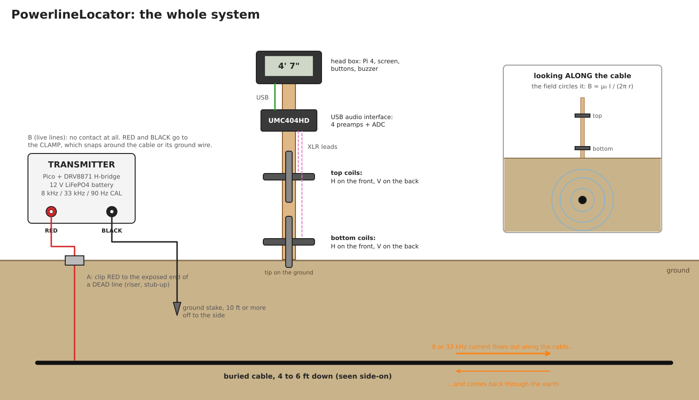
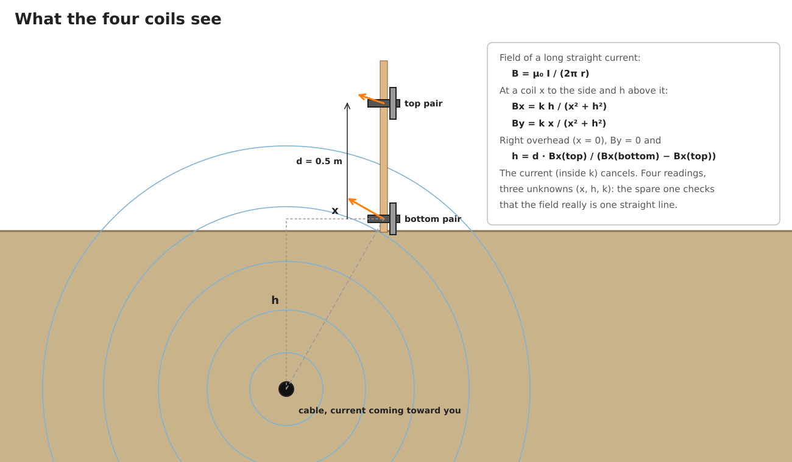
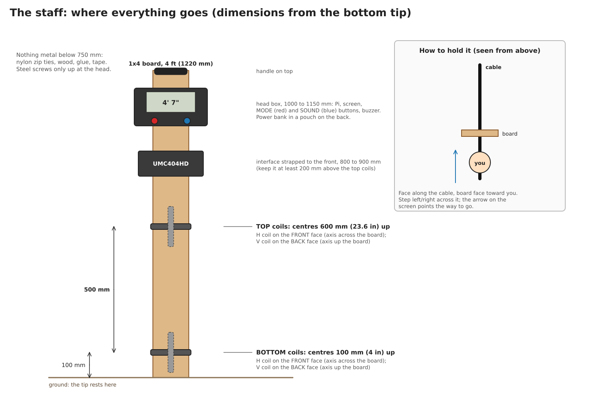
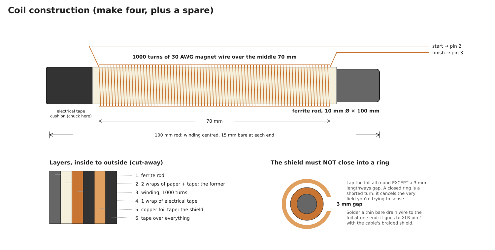
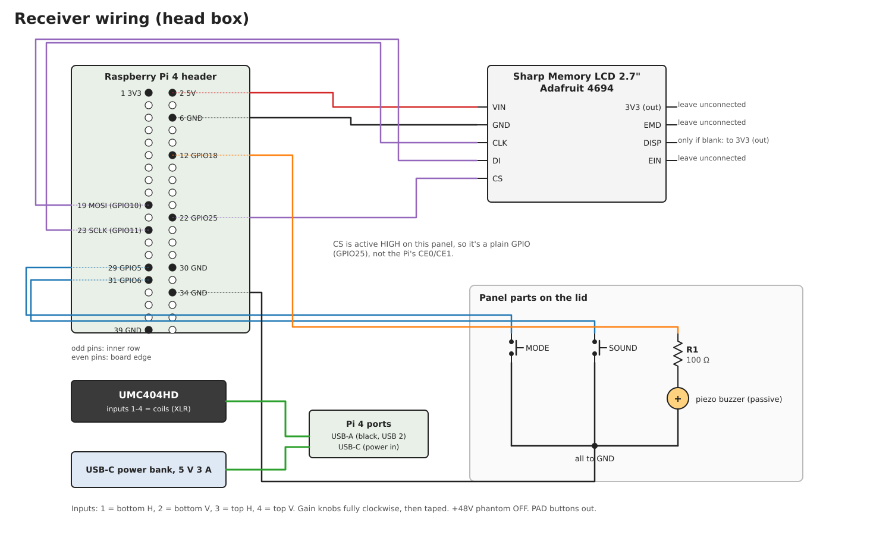
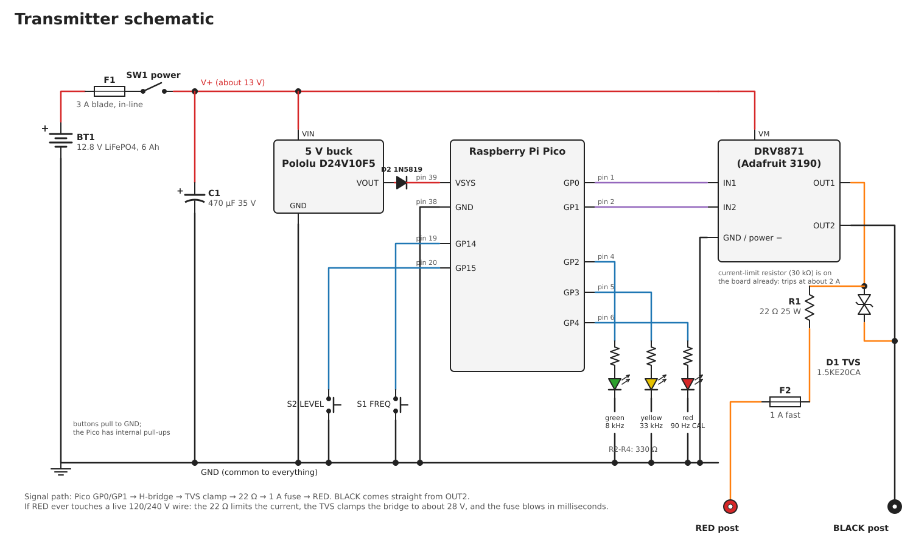
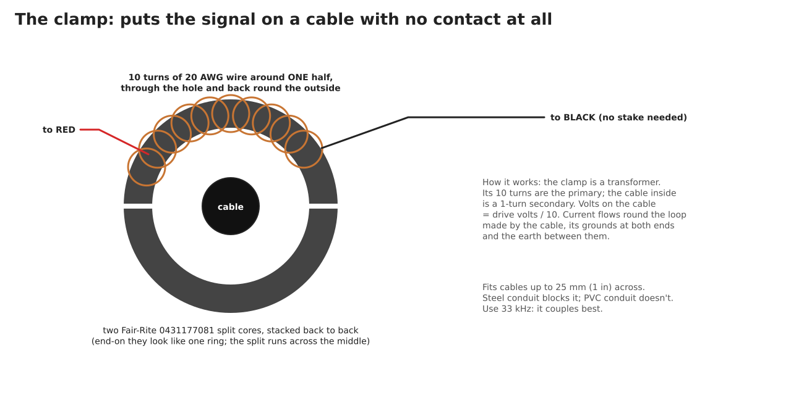

# Schematics and build drawings

Every drawing here is generated by `docs/schematics/make_schematics.py`: change a value there, run it, and the SVGs update. The pins and values match `locator/config.py`, `transmitter/main.py`, [PARTS.md](PARTS.md) and [for_dummies.md](for_dummies.md). If you ever find two of them disagreeing, the code wins; please fix the drawing.

1. [The whole system](#1-the-whole-system)
2. [What the four coils see](#2-what-the-four-coils-see)
3. [The staff](#3-the-staff)
4. [A coil](#4-a-coil)
5. [Receiver wiring](#5-receiver-wiring)
6. [Transmitter](#6-transmitter)
7. [The clamp](#7-the-clamp)

---

## 1. The whole system

The transmitter puts a known current at a known frequency onto the cable you want to find. The receiver is a staff with four coils that listen for that one frequency and work out where the cable is. Power mode skips the transmitter and listens for the 60 Hz that a live, loaded cable already carries.

**Two ways to put the signal on:**

* **A: direct (dead lines only).** RED clips to the exposed end of the line (a pipe stub, a de-energised conductor, a tracer wire). BLACK goes to a ground stake 10 ft or more off to the side. This gives the strongest signal.
* **B: clamp (live or dead).** RED and BLACK both go to the clamp, which snaps round the insulated cable (or round the insulated ground wire from a meter base to its ground rod). It never touches a conductor, so it's the only method to use on anything that might be live. Never put either lead itself on a live conductor: the protection inside only saves the transmitter, and with one lead live, the other lead's clip is live too.

---

## 2. What the four coils see

This is the whole trick in one picture. Measuring two heights gives the depth from a ratio, so the unknown current drops out. Measuring two directions gives left or right. The spare fourth reading is the distortion check.

---

## 3. The staff

| Item | Height from the tip | Mounted |
|---|---|---|
| Bottom H coil (input 1) | 100 mm (centre) | front face, axis across the board |
| Bottom V coil (input 2) | 100 mm (centre) | back face, axis along the board |
| Top H coil (input 3) | 600 mm (centre) | front face, axis across the board |
| Top V coil (input 4) | 600 mm (centre) | back face, axis along the board |
| UMC404HD interface | 800 to 900 mm | front face, two hook-and-loop straps |
| Head box (Pi, screen, buttons, buzzer) | 1000 to 1150 mm | front face, screws allowed |
| Handle | top end | |

The coil heights live in `locator/config.py` (`COILS`). If yours end up somewhere else, measure the centres of the windings and edit those numbers; the software uses them directly. Front and back don't matter to the maths: the cable runs straight away from you, along the board's thickness, and a long straight cable's field is the same all along it.

---

## 4. A coil

| | |
|---|---|
| Core | ferrite rod, 10 mm × 100 mm |
| Winding | 1000 turns of 30 AWG enamelled copper over the middle 70 mm, any neatness |
| Expected resistance | 10 to 16 Ω |
| Expected inductance (if you have an LCR meter) | 40 to 120 mH; the four should be within about 5 % of each other |
| Shield | copper foil tape over a layer of electrical tape, with a 3 mm lengthways gap |
| Lead | 1 m XLR microphone cable, female end cut off |
| XLR pin 1 | cable shield + coil shield drain wire |
| XLR pin 2 | winding start |
| XLR pin 3 | winding finish |

Why 1000 turns and not more: more turns give more signal at 60 Hz, but the winding's own capacitance with its inductance makes it resonate. 1000 turns keeps that resonance well above 33 kHz (around 70 to 100 kHz), so all four coils behave the same way at every frequency we use. Winding direction and which end is pin 2 don't matter: calibration measures each coil's sign.

---

## 5. Receiver wiring

| From (Pi pin) | To | Wire |
|---|---|---|
| 2 (5 V) | Display **VIN** | red |
| 6 (GND) | Display **GND** | black |
| 23 (GPIO11, SCLK) | Display **CLK** | purple |
| 19 (GPIO10, MOSI) | Display **DI** | purple |
| 22 (GPIO25) | Display **CS** | purple |
| 29 (GPIO5) | MODE button, one leg | blue |
| 31 (GPIO6) | SOUND button, one leg | blue |
| 12 (GPIO18) | 100 Ω, then the buzzer's **+** leg | orange |
| 34 (GND) | the other leg of both buttons, and the buzzer's **−** leg | black |
| Pi USB-A (black, USB 2) | UMC404HD USB-B | its included cable |
| Pi USB-C | power bank 5 V 3 A output | USB-C cable |

Display pins **3V3**, **EMD** and **EIN** stay unconnected. **DISP** stays unconnected too, unless the screen stays blank with everything else right: then jumper DISP to the board's own 3V3 pin.

UMC404HD settings, then tape them so a borrower can't bump them: **gain knobs 1 to 4 fully clockwise**, **PAD buttons out**, **+48V phantom OFF** (switch on the back), **MIX knob anywhere**. Calibration is only valid at the knob positions it was done at; fully clockwise is the one position anyone can find again.

---

## 6. Transmitter

**Power:** battery + → F1 (3 A blade fuse) → SW1 → **V+**. V+ goes to C1 (+ side), the buck converter's VIN, and the DRV8871's **VM** (power + terminal). Battery − goes to the DRV8871's power − terminal, which is the common GND.

**Logic:** buck VOUT (5 V) → D2 (1N5819 Schottky, stripe toward the Pico) → Pico **VSYS** (pin 39). Pico GND (pin 38) → GND. D2 is what the Pico's datasheet asks for when VSYS has its own supply: it stops the Pico's USB port feeding 5 V backwards into the regulator while you program it.

| Pico pin | GPIO | Goes to |
|---|---|---|
| 1 | GP0 | DRV8871 **IN1** |
| 2 | GP1 | DRV8871 **IN2** |
| 4 | GP2 | 330 Ω → green LED (8 kHz) → GND |
| 5 | GP3 | 330 Ω → yellow LED (33 kHz) → GND |
| 6 | GP4 | 330 Ω → red LED (90 Hz CAL) → GND |
| 19 | GP14 | FREQ button → GND |
| 20 | GP15 | LEVEL button → GND |
| 38 | GND | GND |
| 39 | VSYS | buck 5 V out, through D2 |

**Output:** DRV8871 **OUT1** → node A. D1 (1.5KE20CA TVS, either way round: it's bidirectional) from node A to **OUT2**. Node A → R1 (22 Ω 25 W) → F2 (1 A fast, 5 × 20 mm) → **RED** post. **OUT2** → **BLACK** post.

**What protects what:**

* F1 protects the battery wiring from a short anywhere in the box.
* R1 limits the output current to well under 1 A even into a dead short, and limits the fault current if RED touches mains.
* D1 clamps the H-bridge's outputs to about 28 V, so a mains touch can't reach the chip while F2 blows.
* F2 opens the output for good on any real fault. **A blown F2 means someone connected to something live**: find out what before replacing it.

**The waveform** is three-level: +V, 0, −V, 0. The "0" parts set the level: HIGH has almost none, MED drives half of each half-cycle, LOW a quarter. The fundamental the receiver listens to is (4V/π)·sin(πα/2), so the levels are 100 %, 71 % and 38 %. Turning the level down is the fix for "bleed-over", where the signal leaks onto neighbouring lines and confuses the receiver.

---

## 7. The clamp

| | |
|---|---|
| Cores | 2 × Fair-Rite **0431177081** snap-on split cores (31 material, 25.65 mm hole), back to back |
| Winding | 10 turns of 20 AWG stranded hook-up wire, around ONE half of both cores together |
| Leads | 1 m twisted pair, red and black, ending in banana plugs |
| Use | 33 kHz, HIGH. Close it round the cable (or the ground wire at a meter base). RED and BLACK both go to the clamp; no ground stake. |

The clamp is a transformer whose secondary is the cable itself: one turn. The induced voltage drives a current round the loop made by the cable, its ground connections at each end, and the earth between them, so it only works on a cable that's grounded at both ends. Power services are (the neutral is bonded at the transformer and at the house); an isolated pump circuit with no ground at the far end may not be, and then direct connection on the dead line is the way.
