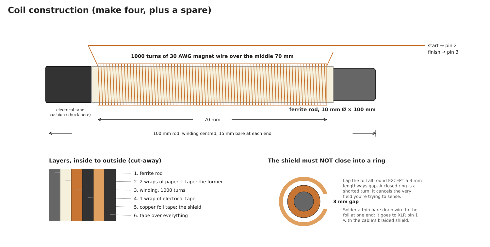
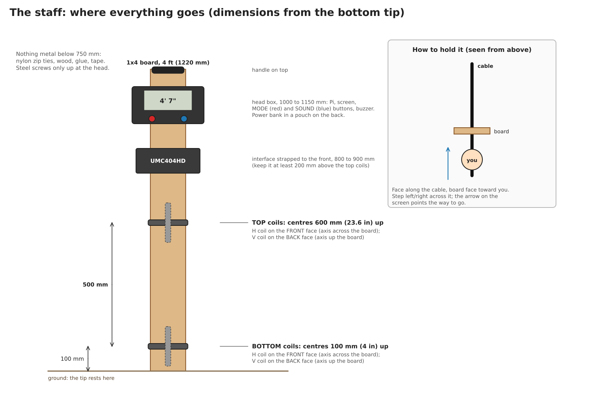
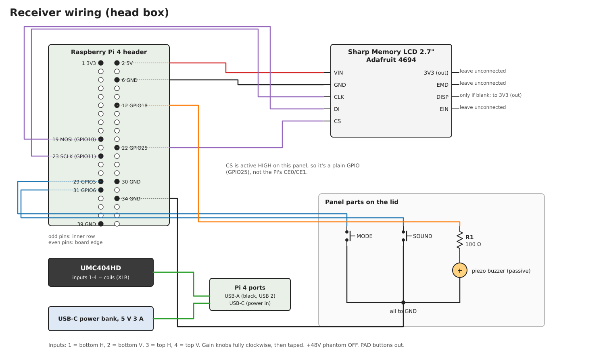
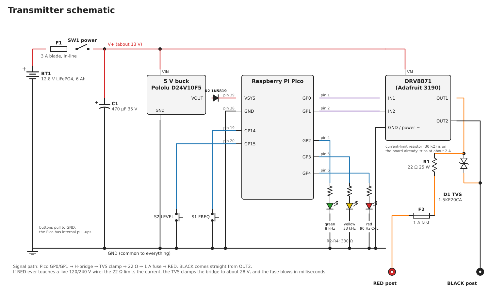
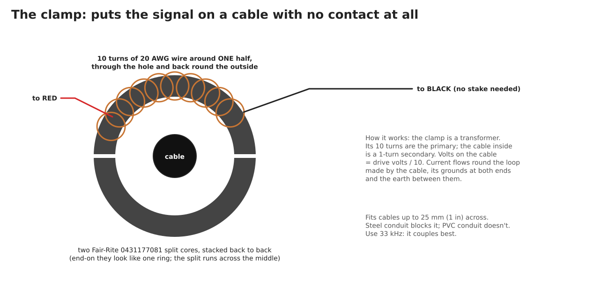

# PowerlineLocator for Dummies: the build

This guide walks through building the whole kit from a pile of parts, assuming you've never wound a coil or wired a Pi before. The [README](README.md) covers how it works and the software; [SCHEMATICS.md](SCHEMATICS.md) has every drawing and wiring table; [PARTS.md](PARTS.md) has the shopping list. Where this guide and a drawing seem to disagree, stop and check: one of them has a mistake.

You don't need to understand the physics to build it. The short version: the transmitter makes a buried cable "hum" at one frequency, and the staff listens for that hum with four coils and works out where it's coming from.

---

## 1. What you're building

Three things that work together.

```text
  THE TRANSMITTER (a box)           THE CLAMP                 THE RECEIVER (a staff)

  battery ─► switch ─► Pico         split ferrite ring         ┌──────────────┐ ◄ head box: Pi, screen,
              │ makes the beat      with 10 turns of wire      │   4' 7"      │   2 buttons, buzzer
              ▼                     │                          └──────┬───────┘
          H-bridge (DRV8871)        │ closes round a cable            │ USB
              │ makes it strong     │ without touching it        ┌────┴─────┐ ◄ UMC404HD: four
              ▼                     │                            │ ▯ ▯ ▯ ▯  │   microphone inputs
          protection ─► RED / BLACK ┘                            └┬──┬──┬──┬┘
                         posts                                    │  │  │  │ XLR cables
                                                                 ═╪══╪═ top coils (600 mm up)
                                                                 ═╪══╪═ bottom coils (100 mm up)
                                                                   tip on the ground
```

Build order: **coils** (the slowest part: an afternoon), **staff**, **head box**, **software**, **transmitter**, **clamp**, **leads**, then **first light**, **calibration** and the **test range**. Each step ends with a check. Don't move on until it passes.

---

## 2. Safety, before anything else

* **Never connect either transmitter lead, RED or BLACK, to anything that might be live.** If one lead is on a live wire, the clip on the other lead is live too, and the fuse can't help you. Live, or not sure: use the clamp, or power mode. The leads only go on a line you've switched off *and* proved dead with your meter.
* **The clamp goes round insulated cable or conduit only,** never a bare conductor.
* **Unplug the Pi before changing any wire on its header.** Every time.
* **Battery first, fuse first.** F1 (the 3 A blade fuse) goes on the battery's + wire before anything else is connected, so a slip of a screwdriver can't weld itself to a terminal.
* **Charge the LiFePO4 battery with its own charger,** outside the closed box.
* **Soldering irons run at about 350 °C.** Use the stand, solder somewhere ventilated, and wash your hands after handling solder.
* **Ferrite rods are brittle,** like pottery. Don't drop them, and never crank a drill chuck tight on one.
* **Hand dig within 18 in of any mark,** this tool's or anyone else's, until you can see the line. That's New Mexico law, and good sense.

---

## 3. New words

### Magnet wire

Copper wire with a thin coat of enamel instead of plastic insulation. The enamel looks like bare copper but it insulates, so two wires touching don't connect. To solder the end you have to get the enamel off: "solderable" enamel melts off under a hot iron (about 380 °C) and a blob of solder; other kinds need scraping with a craft knife until bright copper shows.

### Ferrite rod

A rod of black or dark grey ceramic magnetic material. Wind a coil on it and it pulls in about 60 times more of the passing magnetic field than the same coil in air. Old AM radios used them as antennas.

### XLR

The round 3-pin plug on microphone cables. The **male** plug has three pins and goes into the interface. Each pin's number is moulded in the plastic beside it: **pin 1** is the shield, **pins 2 and 3** carry the signal. Inside the cable: a braided or foil shield and two insulated wires, usually red and white (but check with a meter: Step 4 in Part 1).

### Banana plugs and binding posts

A **binding post** is the screw-cap terminal on the transmitter, red or black. A **banana plug** is the springy 4 mm plug that pushes into its centre. The leads have a banana plug on one end and an alligator clip on the other.

### H-bridge

Four electronic switches arranged so a battery can be connected to two output terminals either way round: + to RED, or + to BLACK. Flip that thousands of times a second and you get an AC signal from a DC battery. The DRV8871 board is an H-bridge.

### Fuses here

* **Blade fuse (F1):** the flat plastic car-type fuse, 3 A, in a holder on the battery wire.
* **Glass fuse (F2):** a 5 × 20 mm glass tube, 1 A fast-blow, in a panel holder on the output. If it ever blows, something live was connected.

### TVS diode

A little component that does nothing until the voltage across it goes over about 20 V, then conducts hard, clamping the voltage. It protects the H-bridge if the output touches something it shouldn't. "Bidirectional" (the "CA" in 1.5KE20CA) means it works either way round, so it can't be fitted backwards.

### LiFePO4

Lithium iron phosphate: a lithium battery chemistry that doesn't catch fire the way phone batteries can. A "12 V" one actually sits around 13.2 V. It has a protection circuit built in.

### Pico

The Raspberry Pi **Pico** is a tiny microcontroller board, not a computer: no operating system, it just runs one program (main.py) from the moment it gets power.

---

## 4. Pins

### The Pi's 40 pins

The pins aren't labelled on the Pi; you find them by position. Lay the Pi flat, components up, with the 40-pin header along the **top** edge and the USB and Ethernet ports on the **right**.

```text
                    the board edge is up here
     pin 2 ► ●  ●  ●  ●  ●  ●  ●  ●  ●  ●  ●  ●  ●  ●  ●  ●  ●  ●  ●  ● ◄ pin 40     ┌──────┐
     pin 1 ► ■  ●  ●  ●  ●  ●  ●  ●  ●  ●  ●  ●  ●  ●  ●  ●  ●  ●  ●  ● ◄ pin 39     │ USB  │
                                                                                     │ ETH  │
             (towards the middle of the board)                                       └──────┘
```

* **Odd pins (1, 3 … 39)** are on the inner row; **even pins (2, 4 … 40)** along the board edge.
* **Pin 1** is the only one with a **square** solder pad (turn the Pi over to see).
* On the Pi, `pinout` in a terminal draws this map with names.

The pins this build uses:

| Pin | Name | Goes to |
|---|---|---|
| 2 | 5 V | Display VIN |
| 6 | GND | Display GND |
| 12 | GPIO18 | 100 Ω, then buzzer + |
| 19 | GPIO10 (MOSI) | Display DI |
| 22 | GPIO25 | Display CS |
| 23 | GPIO11 (SCLK) | Display CLK |
| 29 | GPIO5 | MODE button |
| 31 | GPIO6 | SOUND button |
| 34 | GND | Both buttons' other leg, buzzer − |

### The Pico's 40 pins

The Pico's pin names (GP0, GND, VSYS and so on) are printed on its **underside**. Hold it with the USB socket at the top: **pin 1 (GP0)** is top left, pins count down the left side to **pin 20 (GP15)** at bottom left, then continue up the right side from **pin 21** at the bottom to **pin 40 (VBUS)** at top right. So **pin 39 (VSYS)** is second from the top on the right, and **pin 38** below it is GND.

| Pin | Name | Goes to |
|---|---|---|
| 1 | GP0 | DRV8871 IN1 |
| 2 | GP1 | DRV8871 IN2 |
| 4 | GP2 | 330 Ω → green LED → GND |
| 5 | GP3 | 330 Ω → yellow LED → GND |
| 6 | GP4 | 330 Ω → red LED → GND |
| 19 | GP14 | FREQ button → GND |
| 20 | GP15 | LEVEL button → GND |
| 38 | GND | GND |
| 39 | VSYS | 5 V, through the 1N5819 diode |

---

## 5. Parts tour

| Part | What it does | What to look for |
|---|---|---|
| **UMC404HD** | Four microphone preamps and a converter: turns four coils into numbers for the Pi | 4 combo jacks on the front (XLR in the middle, ¼ in around it), 4 gain knobs, 4 PAD buttons, a +48V switch on the back, USB-B socket on the back |
| **Sharp display** (Adafruit 4694) | The screen | Header pins: VIN, 3V3, GND, CLK, DI, CS, EMD, DISP, EIN |
| **Ferrite rods** | Coil cores | Black/grey, 10 mm across, 100 mm long |
| **Magnet wire** | The coils | A spool of shiny "bare-looking" copper, 30 AWG (about 0.25 mm) |
| **Copper foil tape** | Coil shields | A roll of thin copper with sticky backing |
| **Pico** | Transmitter brain | Green board, USB socket at one end, BOOTSEL button |
| **DRV8871** (Adafruit 3190) | The H-bridge | Small purple board; comes with two blue terminal blocks and a header strip to solder on |
| **Pololu D24V10F5** | Makes 5 V for the Pico from the battery | Tiny blue board marked VIN, GND, VOUT |
| **1N5819** | Lets the battery feed the Pico but not the other way | Small black diode, **grey stripe at one end** (the cathode) |
| **1.5KE20CA** | The TVS clamp | A bigger black diode; may have no stripe (bidirectional: either way round) |
| **22 Ω 25 W resistor** | Limits the output current | Gold aluminium body with two solder tabs and mounting holes |
| **470 µF capacitor** | Steadies the battery voltage under the H-bridge | A can with a **stripe of − signs down one side**: that leg is − |
| **Fair-Rite 0431177081** ×2 | The clamp | Grey plastic clamshells with ferrite halves inside, 25 mm hole |
| **LEDs** | Transmitter frequency lights | **Long leg = +**; the flat edge on the rim is − |

---

## 6. Tools and supplies

* Multimeter (continuity beep, resistance Ω, DC volts)
* Soldering iron and stand, solder, flux
* Wire strippers, flush cutters, craft knife
* Drill, 5 mm bit, step bit (for 16 mm button holes), hand saw
* Hand-crank drill and tally counter (for winding)
* Hot-glue gun, electrical tape, masking tape, a marker
* A crimper for the battery spade connectors

---

## 7. Assembly

### Part 1: Wind the coils (make five: four plus a spare)



**Step 1: Make the former.** Cut a strip of printer paper 70 mm wide and about 120 mm long. Wrap it tightly round the middle of a rod, leaving **15 mm of bare rod at each end**, and tape the seam. Now build a "dam" at each end of the paper: wrap electrical tape round and round in one place, about 5 mm wide, until it stands about 2 mm proud of the paper. The dams stop the wire sliding off.

**Step 2: Mount the rod in the hand drill.** Wrap one bare end in electrical tape until it's a snug fit in the chuck. Push it in and tighten **by hand only**. Clamp the drill's side handle in a vise, or sit and hold it between your knees.

**Step 3: Find the drill's ratio.** Put a marker dot on the rod. Turn the crank exactly 10 times and count how many times the dot goes round. A typical answer is 30 to 45. Divide 1000 by (that number ÷ 10) to get the number of **crank turns** for 1000 rod turns. For example: 10 cranks gave 38 turns, so the ratio is 3.8, and you need 1000 ÷ 3.8 = **263 crank turns**. Write it down.

**Step 4: Wind.** Tape the first 15 cm of magnet wire along the free bare end of the rod (the tail you'll solder later). Then crank, clicking the counter once per crank turn, and guide the wire back and forth between the dams with your other hand, holding it lightly through a folded cloth so it stays gently taut. It doesn't need to be neat: a "scramble" winding is fine. If the wire breaks, stop: unwind to the break, twist and solder the ends, tape over the joint, and carry on counting. At your crank count, cut the wire leaving 15 cm and tape it down.

Wind all five coils the same way, with the same crank count.

**Step 5: Check the winding.** Get the enamel off the last 10 mm of each tail: with "solderable" enamel, touch it with the iron at about 380 °C and a blob of solder until it tins bright silver; otherwise scrape it with the craft knife. Set the meter to Ω and measure between the two tails.

* **10 to 16 Ω:** good. Write the value on a strip of masking tape on the rod.
* **OL (open):** the wire is broken somewhere. Find the break or rewind.
* All five should read within a couple of ohms of each other. If one is way off, its turn count is off: use it as the spare.

If you have an LCR meter, also measure inductance: 40 to 120 mH, and the four you keep within about 5 % of each other.

**Step 6: Insulate and shield.** Wrap one layer of electrical tape over the winding (not the tails). Then wrap copper foil tape over that, lengthways, so it covers the winding from dam to dam, **leaving a 3 mm gap running along the length** so the foil never closes into a complete ring. A closed ring would act as a shorted turn and cancel the very field you're trying to sense. Strip 5 cm of a thin wire (a single strand pulled from scrap hook-up wire works); solder one end quickly onto the foil near the dam on the tail end. This is the **drain wire**. Wrap a final layer of electrical tape over everything, leaving the two tails and the drain wire sticking out.

**Step 7: Find the XLR pins.** Cut the **female** end off an XLR cable, leaving the rest. Strip 40 mm of the outer jacket. Inside: a shield (braid or foil plus a bare wire) and two insulated wires. Set the meter to continuity (beep). Touch one probe to each inner wire's end and the other to the male plug's pins in turn: the numbers are moulded beside the pins. Write down which colour goes to **pin 2** and which to **pin 3**. The shield goes to **pin 1**.

**Step 8: Connect the coil.** Strip 5 mm of the two inner wires.

* Winding **start** tail → the **pin 2** wire.
* Winding **finish** tail → the **pin 3** wire.
* Drain wire → the **shield**.

Twist each pair, solder, and cover each joint with heat-shrink. Then put a bigger piece of heat-shrink or tape over the whole junction, and **zip-tie the XLR cable's jacket to the rod's bare end** so the thin magnet wire never takes any strain.

**Check:** at the XLR plug:

* Pin 2 to pin 3: the same 10 to 16 Ω you measured in Step 5.
* Pin 1 to pin 2, and pin 1 to pin 3: **OL**, no beep. A beep means the shield is touching the winding: unwrap and re-insulate.

Label each plug with tape: **1 BOT H**, **2 BOT V**, **3 TOP H**, **4 TOP V**, **SPARE**.

---

### Part 2: The staff



**Step 1: Cut and finish the board.** Cut the 1 × 4 to **1220 mm** (4 ft). Round the corners of the bottom end with sandpaper so it doesn't splinter. Give it two coats of exterior paint or varnish, and let it dry: a damp board can warp, and warping moves the coils.

**Step 2: Mark the coil centres.** Measuring from the bottom tip, draw lines straight across both faces at **100 mm** and **600 mm**. Pick one face as the **front**. Draw a centre line down the length of both faces.

**Step 3: Drill the zip-tie holes** (5 mm), at each of the two heights:

* For the **H coil** (front face, lying across the board): two pairs of holes, one 10 mm above and one 10 mm below the line, at 25 mm left and 25 mm right of the centre line.
* For the **V coil** (back face, lying along the centre line): two pairs of holes 12 mm either side of the centre line, at 25 mm above and 25 mm below the height line.

**Step 4: Mount the coils.**

* **Front face, 100 mm line:** coil **1 BOT H**, lying across the board, its winding centred on the centre line and the line.
* **Back face, 100 mm line:** coil **2 BOT V**, lying along the centre line, winding centred on the line.
* **Front face, 600 mm:** **3 TOP H**. **Back face, 600 mm:** **4 TOP V**.

Use nylon zip ties through the holes, snug but not crushing. Then put a dab of hot glue at each end of each coil. **Once you calibrate, the coils must never move:** the depth depends on their spacing to a few millimetres.

**Step 5: Route the cables.** Run all four XLR cables up the **back** face to about 800 mm, zip-tied every 10 cm. Coil up any extra length on the back, between 650 and 800 mm, and zip-tie it flat.

**Step 6: The interface.** Strap the UMC404HD to the **front** face between **800 and 900 mm** with the two hook-and-loop straps, its XLR jacks facing **down** toward the coils. Plug **1 BOT H** into input **1**, **2 BOT V** into **2**, **3 TOP H** into **3**, **4 TOP V** into **4**.

Set it up and then **tape the controls**, so a borrower can't change them:

* Gain knobs 1 to 4: **fully clockwise**. Calibration is only valid at the knob positions it was done at, and fully clockwise is the one position anyone can find again.
* PAD buttons: **out**.
* **+48V** switch on the back: **OFF**.

**Check:** no metal screws, brackets or nails below 750 mm. Steel near the coils bends the field, and if it ever moves, the calibration is wrong.

---

### Part 3: The head box



**Step 1: Cut the box.** In the lid: a **60 × 36 mm** window for the screen, two **16 mm** holes for the buttons, and a **5 mm** hole over where the buzzer will sit. In the side or bottom: two holes with grommets (or just smoothed edges) for the USB cables.

**Step 2: The screen.** Glue the acrylic over the window from the inside. Mount the display behind it on nylon standoffs, so the screen sits right against the acrylic.

**Step 3: Buttons and buzzer.** Fit the **red** button (MODE) and **blue** button (SOUND) in the lid. Hot-glue the buzzer behind its hole, + leg marked.

**Step 4: Wire it.** Use F-F Dupont jumpers to the display header; for the buttons and buzzer, cut F-F jumpers in half and solder the cut ends to the parts.

| From (Pi pin) | To |
|---|---|
| 2 (5 V) | Display **VIN** |
| 6 (GND) | Display **GND** |
| 23 (SCLK) | Display **CLK** |
| 19 (MOSI) | Display **DI** |
| 22 (GPIO25) | Display **CS** |
| 29 (GPIO5) | MODE button, either leg |
| 31 (GPIO6) | SOUND button, either leg |
| 12 (GPIO18) | 100 Ω resistor, then buzzer **+** |
| 34 (GND) | MODE's other leg, SOUND's other leg, buzzer **−** (daisy-chain them) |

Leave the display's **3V3, EMD, DISP** and **EIN** pins empty.

**Step 5: Mount it.** Screw the Pi to the box floor on standoffs. Screw the box to the board's front face between **1000 and 1150 mm** (steel screws are fine up here). Fit the handle on top. Put the power bank in a pouch, or zip-tie it, on the back of the board at about 1000 mm. Run its USB-C cable into the Pi's **USB-C** socket, and the UMC404HD's USB cable into one of the Pi's **black** USB ports.

**Check:** before powering anything, set the meter to continuity and check pin 2 (5 V) to pin 6 (GND) on the Pi's header: **no beep**.

---

### Part 4: Software

**Step 1: The SD card.** On your computer, run **Raspberry Pi Imager**. Choose **Raspberry Pi OS Lite (64-bit)**. Before writing, open the settings (the gear, or "Edit settings") and set: hostname **locator**, your username and password, your Wi-Fi, and **enable SSH**. Write the card, put it in the Pi, and power up from the power bank.

**Step 2: Log in and install.** From your computer:

```bash
ssh yourname@locator.local
git clone https://github.com/FatCharlie/PowerlineLocator
cd PowerlineLocator
sudo ./RPI_SETUP.sh
sudo reboot
```

**Step 3: Checks.** Log back in, then:

```bash
cd PowerlineLocator
python3 selftest.py                        # should end "50 passed, 0 failed"
sudo systemctl stop powerline-locator      # free the interface for the checks
python3 check_hw.py --interactive
```

`check_hw.py` tests the Pi, the packages, the interface (all four inputs alive, nothing clipping), the screen (you look and answer), and the buzzer and buttons (you listen and press). Fix anything marked FAIL before going on; each failure prints its fix.

**Step 4: Coil test.** Plug a lamp into an extension cord and switch it on. Then:

```bash
python3 check_hw.py --live
```

Hold the staff so each coil in turn passes close to the cord. That input's bar should jump. If one never moves, check that coil's XLR plug, its input number and its gain knob.

The screen's own CALIBRATION check will still FAIL: that's Part 9.

---

### Part 5: The transmitter



**Step 1: Program the Pico first, on its own.**

1. Download the MicroPython **.uf2** file for the Raspberry Pi Pico from micropython.org (Download → RPI_PICO; or RPI_PICO2 for a Pico 2).
2. Hold the Pico's **BOOTSEL** button while you plug it into your computer's USB. A drive called **RPI-RP2** appears. Drag the .uf2 file onto it; the Pico restarts.
3. Install **Thonny** (thonny.org). Bottom-right corner: choose **MicroPython (Raspberry Pi Pico)**.
4. Open `transmitter/main.py` from this repo. **File → Save as → Raspberry Pi Pico**, name it **main.py**.
5. Press the red **Stop/Restart** button in Thonny.

**Check:** Thonny's shell prints `output 8192.00 Hz, level HIGH`, and the Pico's own LED blinks briefly every 2 seconds.

**Step 2: The Pico board.** Solder the header pins to the Pico (skip this with a Pico H), then solder the Pico onto the Perma-Proto board so each of its pins has a strip of free holes beside it. On the Perma-Proto:

* The three LEDs, each with its 330 Ω resistor: GP2 (pin 4) → 330 Ω → **green** LED long leg; short leg → GND. Same for GP3 (pin 5) → **yellow** and GP4 (pin 6) → **red**. Use wires long enough to reach the box lid.
* Two wires each for the FREQ and LEVEL buttons: GP14 (pin 19) and GND; GP15 (pin 20) and GND.
* The **1N5819**: its **striped end** (cathode) to **VSYS (pin 39)**; the other end is where the 5 V regulator's output will connect.
* A wire from Pico **GND (pin 38)** for the common ground.

**Step 3: Battery, fuse and switch.** Crimp the female spade connectors onto an 18 AWG red and an 18 AWG black wire. Put the **in-line blade fuse holder on the red wire**, right by the battery, with its 3 A fuse **out** for now. Red then goes to one side of the power switch. The other side of the switch is **V+**.

**Step 4: The 5 V regulator.** V+ → Pololu **VIN**. Battery black → Pololu **GND**. Leave its other pins unconnected.

**Check:** Pico **not** connected yet. Put the fuse in, connect the battery, switch on. Measure Pololu **VOUT** to **GND**: **4.9 to 5.1 V**. Switch off.

Then connect VOUT to the 1N5819's un-striped end, and Pololu GND to the Pico's GND wire.

**Step 5: The H-bridge.** Solder the DRV8871's two terminal blocks and its header (they come loose in the bag). Wire it by the printed labels:

* **Power terminal block**: + ← V+; − ← battery black. This − is the common GND.
* **470 µF capacitor** across that same terminal block: its **− stripe** leg to −, the other to +.
* **IN1** ← Pico GP0 (pin 1). **IN2** ← Pico GP1 (pin 2). **GND** header pin ← the Pico's GND wire.

**Check:** with the switch on, the green LED lights steadily, and the Pico's own LED blinks every 2 s. Switch off.

**Step 6: The output.** On the DRV8871's **motor** terminal block (OUT1, OUT2):

* The **1.5KE20CA** goes straight across OUT1 and OUT2, either way round.
* **OUT1** → one tab of the **22 Ω 25 W** resistor. Other tab → the **panel fuse holder** (1 A fast fuse). Fuse holder's other terminal → **RED** binding post.
* **OUT2** → **BLACK** binding post.

Use 18 AWG for all of this.

**Step 7: Into the box.** Drill the lid or front for: the two binding posts, the panel fuse holder, the power switch, the FREQ and LEVEL buttons, and the three LEDs. Strap the battery to the box floor (zip ties through holes, or a bracket) so it can't slide. Screw the 22 Ω resistor flat to the box wall or a scrap of aluminium: it warms up if the output is shorted. Stick the Perma-Proto, regulator and DRV8871 down with standoffs or hot glue.

**Check, with nothing on the posts:** switch on. Green LED steady. Press **LEVEL**: green blinks slowly (MED), then fast (LOW), then steady again (HIGH). Press **FREQ**: yellow (33 kHz), then red (90 Hz CAL), then green. Set the meter to **DC volts** across RED and BLACK: close to **0 V** (the wave averages to zero). Switch off.

---

### Part 6: The clamp



1. Open both Fair-Rite cores and stand them **back to back**, so their holes line up into one 25 mm tunnel and their hinges are on the same side. Tape the two cases together (top halves together, bottom halves together), keeping the hinges free.
2. With 20 AWG stranded wire, wind **10 turns around the top half** of both cases together: through the tunnel and back round the outside, over and over. Keep the turns pressed against the inside of the tunnel so the cable still fits.
3. Twist the two leads together for 1 m and fit banana plugs: one red, one black. (Which is which doesn't matter for the clamp; the colours just match the posts.)
4. Hot-glue the turns to the case so they can't slide off when you open it.

**Check:** continuity from banana to banana: **beep**, a fraction of an ohm. Close and open the clamp: it should snap shut fully, with the ferrite faces touching.

---

### Part 7: Leads and stakes

* **RED lead:** a banana-to-alligator test lead.
* **Short BLACK lead:** the other test lead, for the clamp or a stake close by.
* **Long ground lead:** 50 ft of 16 AWG with a banana plug on one end and a big alligator clip on the other. Wind it on a scrap of plywood.
* **Two ground stakes.**

---

### Part 8: First light

Do this on open ground, away from fences and buried lines.

1. Lay 20 m (65 ft) or more of the calibration wire **dead straight** on the ground.
2. Far end: clip it to a stake pushed into the ground. Near end: clip it to the transmitter's **RED**. Second stake 2 to 3 m off to the side of the near end, to **BLACK** with the long lead. If the ground is very dry, pour a litre of water round each stake.
3. Transmitter on: **8 kHz** (green), **HIGH**.
4. Receiver: power on and wait for the screen (about 30 s from cold). MODE until it shows **8 kHz**.
5. Walk to the middle of the wire, face along it, staff upright, tip on the ground.

**Check:** the signal bar is high, well over 40 dB. Step sideways across the wire: the bar peaks right over it. The screen will say NOT CALIBRATED: that's next.

---

### Part 9: Calibration

Calibration measures each coil's gain relative to the bottom H coil, once per frequency. It's what makes the depth honest, so take your time. You need the same setup as Part 8.

```text
            wire (20 m+, dead straight on the ground)
   ─────────────────────────────────────────────────────────── 
          ▲        ▲        ▲        ▲
       31.5 in  19.7 in  19.7 in  31.5 in      ◄ flags, measured square to the wire
       (0.8 m)  (0.5 m)  (0.5 m)  (0.8 m)
       ◄──── your LEFT        your RIGHT ────►

   You stand at the middle, facing along the wire, board face toward you.
   "The wire is 19.7 in to your RIGHT" means: plant the tip 19.7 in to the LEFT
   of the wire, so that the wire is on your right.
```

1. Put four flags at the distances above, measured square to the wire, at its middle.
2. Free the interface and run calibration:

   ```bash
   sudo systemctl stop powerline-locator
   python3 calibrate.py
   ```

3. It asks for **8 kHz** first. Set the transmitter, press Enter. For each position it names, plant the tip at the flag, staff **upright** (check it against something vertical), stand still, press Enter, and keep still for about 4 seconds.
4. Then **33 kHz**, then **90 Hz CAL**, the same way.

At the end of each frequency it prints each coil's gain and fit error. **Every fit error should be under 3 %.** If one isn't, the usual causes are: a flag off by more than an inch, the staff tilted, metal nearby, or a coil that's shifted on the board. Fix it and re-run just that frequency, e.g. `python3 calibrate.py --only 8192`.

**Check:** `python3 check_hw.py --only cal` shows all three as PASS. Restart the service (`sudo systemctl start powerline-locator`): the screen now shows a depth when you stand over the wire. Right over the wire it should read about **0' 0"** to **0' 1"** (the wire is lying at the tip) with ON LINE, and from each flag the arrow should point at the wire and give about the flag's distance.

---

### Part 10: The test range, then lock it down

A wire on the ground proves the gains; only a wire at a **known depth** proves the depth. Next time you have a trench open (the pump room, the catchment line), lay 20 m of wire along the bottom at a measured 4 ft, with both ends brought up to the surface on stakes, before you backfill. That's your permanent test range.

1. Connect the transmitter to one end; ground the other end's stake.
2. Stand over the middle, ON LINE, and read the depth. Then turn round 180° and read it again: on a clean, single line the two readings agree.
3. **Good:** within about 10 % of the real depth (4 ft reads between 3' 7" and 4' 5").

When it reads right, lock the SD card so a pulled battery can never corrupt it:

```bash
./lockdown.sh on
sudo reboot
```

To recalibrate or update later: `./lockdown.sh off`, reboot, do the work, `./lockdown.sh on`, reboot.

---

## 8. Using it

### Pick a method

| Situation | Method | Transmitter |
|---|---|---|
| Line is **off** and proved dead, with an exposed end (pipe stub, cable end, tracer wire) | **Direct**: RED to the line, BLACK to a stake 10 ft+ off to the side, at right angles to where the line probably runs | 8 kHz, HIGH |
| Line is or might be **live**, and you can get at it above ground (a riser, a meter's ground wire) | **Clamp** round it; RED and BLACK both to the clamp; no stake | 33 kHz, HIGH |
| Line is live and you can't reach it | **Power mode**: no transmitter. Turn on a big load at the far end | none |

### Find it

1. Start near where the line comes out of the ground, a few steps away along its likely route.
2. Hold the staff upright, tip just touching the ground, board face toward you.
3. **Find the direction:** turn on the spot. The signal is strongest when you're facing along the line.
4. **Find the centre:** step sideways. Follow the arrow (`< 7 in` means step left). At ON LINE the buzzer double-chirps. Mark the spot with a flag or paint.
5. **Read the depth** only when it's ON LINE and not DISTORTED. Turn round 180° and read it again: the two should agree.
6. **Follow it:** every few steps, find the centre again and mark it.

### Reading DISTORTED

The field doesn't match one straight line. Don't trust the depth there. Try, in order:

* **Turn the level down** (LEVEL button). The signal may be bleeding onto a neighbouring line.
* **Move the ground stake** further away and at right angles to the line. Signal coming back along a shallow wire or a fence will distort everything near it.
* **8 kHz** instead of 33 kHz: lower frequency bleeds less.
* **Move a few steps along the line.** Bends, tees and splices distort the field near them, and it clears beyond.
* If it's DISTORTED everywhere on a stretch, there may be two lines close together. Treat the whole stretch as "line here somewhere": dig by hand.

---

## 9. The lending card

Print this, laminate it, and zip-tie it to the staff.

```text
POWERLINE LOCATOR

FIRST: call 811 (or nm811.org) for the utility's own lines. This finds the rest.

1. Live line?   Clamp it (33 kHz) or use 60 Hz POWER mode.
                NEVER clip RED or BLACK to anything that might be live.
                Clamp only round insulated cable, never bare wire.
   Dead line?   RED to the line, BLACK to a stake 10 ft off to the side (8 kHz).
2. Staff upright, tip on the ground, board face toward you, facing along the line.
3. Step the way the arrow points. ON LINE = double beep. Mark it.
4. Depth: trust it only at ON LINE and not DISTORTED. Turn round: it should agree.
5. DISTORTED: turn LEVEL down, move the stake further away, move along the line.
6. HAND DIG within 18 in of every mark until you see the line.

Don't turn the knobs on the grey box. Charge the battery with its own charger.
Blown fuse on the transmitter = it was connected to something live. Tell me.
```

---

## 10. Common mistakes

| Symptom | Likely cause |
|---|---|
| A coil reads OL between pins 2 and 3 | Broken magnet wire, or enamel not removed at a joint |
| A coil beeps between pin 1 and pin 2 or 3 | The shield foil touches the winding: re-insulate under it |
| One input dead in `check_hw.py --live` | Wrong input number, gain knob down, or a bad XLR joint |
| An input CLIPPING | **+48V phantom is on.** Switch it off on the back of the interface. |
| Screen blank | Display VIN/GND swapped or loose; SPI off (`check_hw.py --only pi`); try DISP to the display's own 3V3 pin |
| Screen text mirrored | Set `DISPLAY_MIRROR = True` in `locator/config.py` |
| Calibration fit error over 3 % | Flags off, staff tilted, metal nearby, or a coil moved on the board |
| Depth reads about the same everywhere and wrong | Calibrated with the knobs in a different place: put them fully clockwise and recalibrate |
| WEAK SIGNAL at a few feet | Stake in dry ground (water it, push it deeper); transmitter on LOW; far end of the line not grounded (clamp needs both ends grounded) |
| DISTORTED near the transmitter | Normal: the stake's return current is close by. Walk further along the line. |
| Pico does nothing at power-on | main.py not saved **on the Pico**; or the 1N5819 is in backwards (stripe goes to VSYS) |
| Transmitter's output fuse blew | RED was connected to something live. Find out what before replacing it. |
| Everything worked, then calibration "forgot" itself | It was done while the card was locked: `./lockdown.sh off`, reboot, recalibrate, lock again |

---

## 11. Glossary

| Word | Meaning |
|---|---|
| **AWG** | American Wire Gauge: bigger number, thinner wire. 30 AWG is about 0.25 mm; 18 AWG about 1 mm. |
| **Bleed-over** | The transmitter's signal leaking onto neighbouring lines, so they show up too |
| **Calibration** | Measuring each coil's sensitivity relative to the others, so their ratio means something |
| **Clamp** | A split ferrite ring that puts the signal on a cable by induction, without touching it |
| **dB** | A log scale. Here, how far the signal is above the noise: 20 dB = 10×, 40 dB = 100×, 60 dB = 1000× |
| **Direct connection** | RED clipped to the line itself, BLACK to a ground stake |
| **Distortion** | The field not matching the shape of one straight line |
| **Drain wire** | A bare wire that connects a foil shield to ground |
| **Lock-in** | Measuring the signal at exactly one frequency and ignoring everything else |
| **Phantom power (+48V)** | Power a mic interface can send down the cable for condenser mics. Off, for coils. |
| **Power mode** | Listening for the 60 Hz a live, loaded cable carries, with no transmitter |
| **Tolerance zone** | 18 in either side of a mark, where New Mexico law says to dig by hand |
| **Tracer wire** | A copper wire buried with a plastic pipe so the pipe can be found later. Always lay one. |
